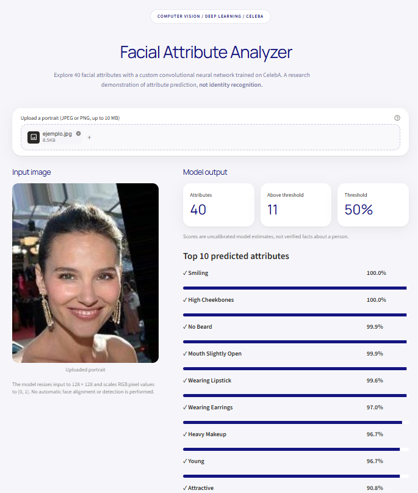

# Facial Recognition System

**From a custom CNN trained on CelebA to personalized face recognition with transfer learning — plus an interactive demo of the original 40-attribute model.**


## Interactive demo — Facial Attribute Analyzer

The demo runs **my CNN trained from scratch** on CelebA. Upload a single portrait to explore the model's **40 facial-attribute scores**, ranked by probability and grouped by category. Adjust the threshold and export predictions as JSON.



> **Two different tasks:** the public demo predicts **facial attributes**, not someone's identity. The separate transfer-learning experiments address **binary target-person-versus-others recognition** and are described below.

**Demo features:**
- Upload a JPEG or PNG portrait (up to 10 MB).
- Display the input image and the top predicted attributes.
- Explore all 40 outputs and categories (expression, hair, facial features, accessories).
- Adjust the classification threshold without rerunning the CNN.
- Download prediction scores as JSON.

### Run the demo locally

Tested locally on **Windows with Python 3.13** and the original `celebA_grande_mejor.h5` checkpoint. From the repository root:

```powershell
py -3.13 -m venv .venv
.\.venv\Scripts\python.exe -m pip install --upgrade pip
.\.venv\Scripts\python.exe -m pip install -r requirements-demo.txt
.\.venv\Scripts\python.exe -m streamlit run demo/app.py
```

Open **http://localhost:8501** if it does not open automatically.

The demo expects this checkpoint at:

```text
Modelo CNN celebA/celebA_grande_mejor.h5
```

If the checkpoint is missing from your local clone, obtain the project's original model file separately and place it at that path. The demo **does not** use personalized identity-recognition checkpoints. CPU inference is sufficient for single photos; installation and inference time depend on your system.

**Command-line alternative:**

```powershell
.\.venv\Scripts\python.exe predict.py --image ejemplo.jpg --top 10
```

The model resizes input to **128 × 128 RGB** and normalizes pixels to **[0, 1]**. It does **not** automatically detect, crop, or align faces; a single well-framed face works best. The names and ordering of the 40 attributes follow the **standard CelebA convention** and should be cross-checked against the original training CSV if available.

## Project overview

This research explores whether visual representations learned by a convolutional neural network (CNN), trained **from scratch** on a multi-label facial-attribute task, can transfer to a smaller, personalized face-recognition task.

The work consists of three stages:

1. **CNN on CelebA:** learn 40 facial attributes from a large annotated dataset.
2. **Transfer Learning v1:** adapt the pretrained CNN to a binary task (`yo` vs. `otros`).
3. **Transfer Learning v2:** study class weighting, stronger augmentation, and classification thresholds to address class imbalance.

The identity experiments are research prototypes, **not** production-ready authentication, face identification across multiple named people, or anti-spoofing systems.

## Methodology

### Stage 1 — CNN trained from scratch

- **Dataset:** CelebA, 202,599 images with 40 binary attributes.
- **Input:** 128 × 128 RGB images, normalized to [0, 1].
- **Architecture:** convolutional blocks with 64 → 128 → 256 → 512 filters, pooling, global average pooling, dense layers, and **40 sigmoid outputs**.
- **Training:** Adam, binary cross-entropy, checkpoints, early stopping, and learning-rate reduction.
- **Best recorded validation binary accuracy:** **91.50%**.

**Note:** This metric measures individual *attribute-label predictions*; it is **not** identity recognition accuracy.

### Stage 2 — Personalized transfer learning (v1)

The original 40-attribute classification head is replaced with a binary classification head. The pretrained convolutional representation is used first with a frozen backbone, followed by fine-tuning while keeping its first ten layers frozen.

```text
128 × 128 RGB image
         ↓
  Pretrained CNN backbone
         ↓
 Global Average Pooling
         ↓
  Binary classifier
         ↓
Target person / Others
```

### Stage 3 — Class imbalance and thresholds (v2)

The second experiment introduces stronger image augmentation, class weighting, and a validation-set sweep of classification thresholds. Its aim is to improve recall on the underrepresented positive class rather than maximize raw accuracy alone.

## Recorded results

### Personalized binary recognition — validation

| Metric | Transfer Learning v1 | Transfer Learning v2 |
|:--|--:|--:|
| Accuracy | 97.69% | 97.22% |
| Precision | 100.00% | 75.00% |
| Recall | 68.75% | 93.75% |
| F1-score | 81.48% | 83.33% |
| Decision threshold | 0.50 | 0.60 |

The v1 F1-score is derived from the recorded validation confusion matrix. The v2 numbers correspond to a threshold of **0.60** in `Transfer Learning v2/umbrales.csv`.

**Interpretation:** v2 detects more positive examples, but produces more false positives. Its higher recall does **not** imply superior security or overall performance in every application.


### Evaluation limitations

- These metrics come from the project's **validation set**, not an independent external benchmark.
- V2 threshold selection and reporting used validation predictions, so the reported performance needs confirmation on a completely untouched test set.
- The original personal images and full data-splitting pipeline are not included in this public demo.
- No presentation-attack detection, demographic fairness study, or deployment security audit is documented.
- CelebA labels such as `Attractive`, `Male`, and `Young` represent dataset annotations, **not verified or objective statements about people**; high scores should not be mistaken for calibrated certainty.

## Repository structure

```text
Reconocimiento-Facial/
├── .streamlit/
│   └── config.toml                # Streamlit theme settings
├── Modelo CNN celebA/
│   ├── entrenar_celebA_grande.py  # Train 40-attribute CNN
│   ├── historial_grande.json      # Training history
│   └── celebA_grande_mejor.h5     # Original CelebA model checkpoint
├── Transfer Learning/
│   ├── transfer_yo.py             # Binary classifier, v1
│   └── historial_*.pkl            # Training histories
├── Transfer Learning v2/
│   ├── transfer_yo_v2.py          # Weighted binary classifier, v2
│   ├── historial_*.pkl
│   ├── umbrales.csv
│   └── curvas_umbrales.png
├── demo/
│   ├── app.py                     # Interactive Streamlit app
│   ├── README-demo.md
│   └── assets/
│       └── facial-analyzer-demo.png
├── predict.py                     # Shared inference engine + CLI
├── requirements-demo.txt          # Inference/demo dependencies
├── DESIGN.md                      # UI style reference
├── Reporte.ipynb                  # Original research report
├── .gitignore
└── README.md
```

*Personalized identity-recognition `.h5` checkpoints are intentionally omitted from the public-oriented tree. If they have previously been committed, removing them from the latest commit does not remove them from Git history.*

## Research-code reproduction notes

The original training scripts were created in a GPU-equipped computing environment and contain absolute paths from that environment. They are preserved as research code, **not** one-command reproducible pipelines.

To reproduce the experiments, obtain [CelebA from its source](https://mmlab.ie.cuhk.edu.hk/projects/CelebA.html) under its applicable terms, update dataset and checkpoint paths in the training scripts, and create authorized, separated training/validation/test data for the personalized experiments. Keep a held-out test set that is not used for model training or threshold selection.

## Privacy and responsible use

Only process images you are authorized to use. This local demo does not intentionally persist uploaded portraits to disk or call an external inference API; if hosted remotely, photos are sent to **that host** for processing. Do not publish personal training photos or personalized identity-recognition model checkpoints without considering biometric privacy and consent.

This project is intended for education, research, and portfolio demonstration — **not** for access control or high-stakes decisions.

## What I learned

- Designing and training a multi-label CNN from scratch.
- Transferring learned representations to a different classification task.
- Comparing frozen feature extraction and fine-tuning.
- Addressing class imbalance and reasoning about precision versus recall.
- Evaluating decision thresholds and identifying limitations in validation-only reporting.
- Turning an experimental `.h5` model into a local Python/Streamlit demonstration.

## Author

**Jorge Arturo Uc Torres** · [@Slowpokeislife](https://github.com/Slowpokeislife)
